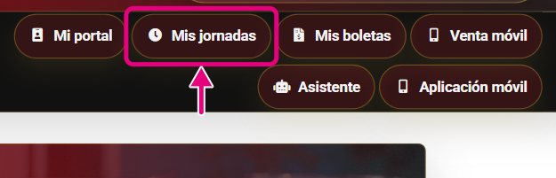
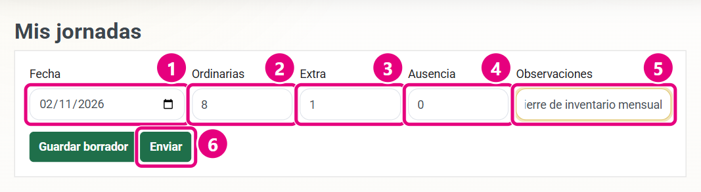
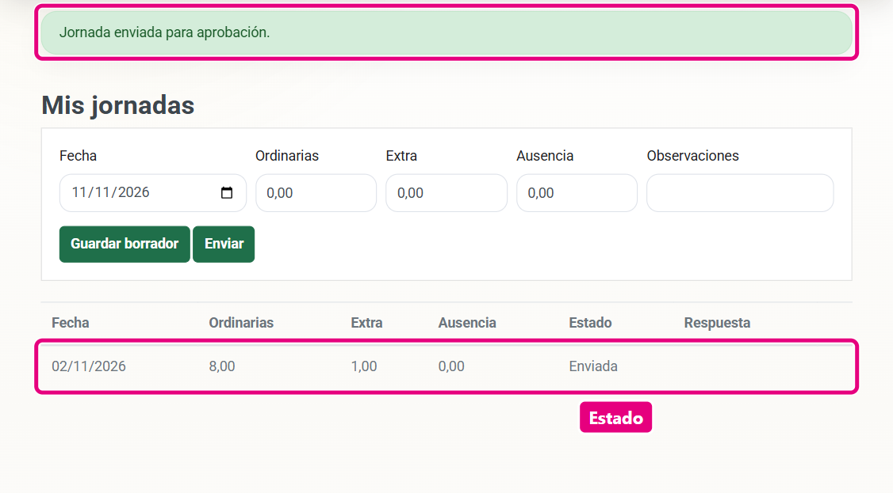
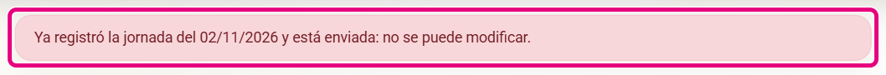

# Guía de estilo para escribir el manual

Esta guía es para las sesiones que escriben las partes por puesto. Léala completa antes de empezar. El modelo a copiar es el capítulo de ejemplo del final (**Mis jornadas**), que ya está en el manual: `capitulos/23_empleado/30_mis_jornadas.md`. Las herramientas se explican en `HERRAMIENTAS.md` y el reparto en `mapa_puestos_modulos.md`.

## 1. A quién le escribimos

A un empleado que **no sabe de computación** y que quiere terminar una tarea. Lee con prisa, salta a la sección que necesita y sigue las imágenes.

## 2. Tono

- **Trate al lector de usted**, en imperativo: «Haga clic en **Guardar**», «Escriba el correo». No use «vos» ni «tú» (aunque la pantalla diga «Ingresá», el texto del manual dice «Ingrese»). Los textos de la pantalla se copian **tal cual**, en negrita o entre comillas.
- **Frases cortas**: una idea por frase, unas 20 palabras como máximo. Párrafos de 1 a 3 frases.
- **Sin tecnicismos ni códigos internos.** Nada de nombres de permisos (`PEDIDOS_VER`), procedimientos, tablas, controladores, direcciones internas (`/OrdersAdmin/Index`), «registro», «base de datos», «sesión HTTP». Diga «el sistema», «la pantalla», «el módulo», «la lista».
- **Verbos concretos:** «Haga clic» (computadora), «Toque» (teléfono), «Escriba», «Elija», «Marque».
- **Nombres exactos** de botones, campos, menús y estados, en **negrita**: **Guardar cambios**, **Enviada**.
- Rutas de menú con flechas: **Administración → Inventario → Movimientos**.
- Sin opiniones ni historia del sistema. Sin «simplemente», «obviamente», «fácilmente».
- Números con cifra: «5 intentos», «45 minutos». Montos en colones: «₡25 000».
- Si una función tiene hoy una limitación, dígalo en un cuadro **ADVERTENCIA** con qué hacer. No invente comportamientos: compruébelos en el sistema.

## 3. Estructura de un capítulo

Un capítulo = **un módulo** de su parte (vea `mapa.json` o `mapa_puestos_modulos.md`). Cada procedimiento lleva esta estructura fija, con estos títulos exactos:

```markdown
# Nombre del módulo {#mod-ancla-de-mapa-json}

Una o dos frases: qué es el módulo y para qué lo usa este puesto.

## Verbo + objeto (por ejemplo: Registrar una jornada) {#mod-ancla-accion}

### Para qué sirve
### Quién puede usarlo
### Pasos
### Resultado esperado
### Si algo sale mal
```

- **Para qué sirve:** 1–2 frases sobre el resultado de negocio, no sobre la pantalla.
- **Quién puede usarlo:** los puestos con acceso (cópielos de `mapa.json`; si es solo consulta, dígalo).
- **Pasos:** lista numerada. Cada captura va **debajo del paso que ilustra**, con 3 espacios de sangría. Si la captura tiene números de paso, debajo va una sublista numerada (1., 2., 3.) que **coincide** con los números de la imagen.
- **Resultado esperado:** el mensaje exacto que aparece y cómo se ve el cambio (estado, fila nueva…). Una captura si ayuda.
- **Si algo sale mal:** tabla `| Mensaje | Qué hacer |` (o `| Mensaje | Causa | Qué hacer |`) con los mensajes **reales**. Para conocerlos: provoque el error en su base, o búsquelos en el código (`TempData["ErrorMessage"]`, `ModelState.AddModelError`, `ErrorMessage =` de los modelos, `THROW` de los procedimientos) y cópielos tal cual.

Un módulo con un solo procedimiento sencillo puede tener solo ese `##`. Los módulos de consulta (reportes, tableros) usan «Consultar …», «Filtrar …», «Exportar …».

### Títulos y anclas

- `#` = capítulo (sale numerado: «23. Mis jornadas»). `##` = procedimiento («23.1»). `###` = las cinco secciones fijas (no van al índice). No escriba los números: el generador numera.
- El `#` **debe** llevar el ancla del módulo tal como está en `mapa.json` (`{#mod-…}` o `{#app-…}`): de ella dependen los enlaces automáticos de las otras partes. Si un módulo no tiene archivo, el Word muestra un capítulo provisional «en preparación».
- Cada `##` lleva `{#<ancla-del-módulo>-<acción>}` para que otros puedan enlazar un procedimiento concreto.

### Enlaces

- **Nunca escriba el procedimiento de un módulo de otra parte.** Enlácelo: `[Aprobar jornadas](#mod-aprobar-jornadas)`. La tabla «Módulos de otras partes que también usa este puesto» se genera sola al inicio de cada parte.
- Funciones comunes ya escritas en la Parte I (no las repita): `#gen-login`, `#gen-recuperar`, `#gen-navegacion`, `#gen-navegacion-puestos`, `#gen-navegacion-denegado`, `#gen-perfil`, `#gen-notificaciones`, `#gen-cerrar-sesion`, `#gen-app-instalar`, `#gen-app-actualizar`, `#gen-app-login`, `#gen-app-inicio`, `#gen-app-notificaciones`, `#gen-app-cerrar`, `#gen-faq`.
- Partes: `#parte-administrador`, `#parte-gerente`, … `#parte-app` (el sufijo es el `id` de `mapa.json`).

### Cuadros

```markdown
> [!NOTA] Información que complementa.

> [!CONSEJO] Atajo o buena práctica.

> [!ADVERTENCIA] Riesgo de error, pérdida de datos o problema con un cliente.
```

Máximo 2 o 3 por procedimiento. Si todo es advertencia, nada lo es.

### Otros

- Tablas Markdown normales (la primera fila es el encabezado).
- `<!-- salto -->` fuerza un salto de página (úselo poco).
- Dos imágenes en la **misma línea**, separadas por un espacio, salen lado a lado (útil para dos pantallas del teléfono).

## 4. Archivos

- Capítulos: `capitulos/<carpeta de su parte>/NN_tema.md` (la carpeta está en `mapa.json`). Numere de 10 en 10 (`10_`, `20_`…) en el orden de `mapa.json`, para poder intercalar. Opcional: `00_puesto.md` con `# Su trabajo en el sistema {#puesto-<id>}` (la rutina diaria del puesto).
- Los archivos que empiezan con `_` se ignoran (borradores). Codificación UTF-8.
- No edite archivos de otra parte. Si necesita cambiar `mapa.json` (por ejemplo, el dueño de un módulo), pídaselo al gerente.

## 5. Capturas

- **Nombre:** `<prefijo>-<módulo>-<nn>`, en minúsculas y sin tildes: `ger-rutas-01`, `app-mis-rutas-03`, `cli-carrito-02`.

  | Parte | Prefijo | Carpeta y especificación |
  |---|---|---|
  | General | `gen` | `capturas/general`, `capturas/specs/general.json` |
  | Administrador | `adm` | `capturas/administrador`, `capturas/specs/administrador.json` |
  | Gerente | `ger` | `capturas/gerente`, `capturas/specs/gerente.json` |
  | Supervisor | `sup` | `capturas/supervisor`, `capturas/specs/supervisor.json` |
  | Auditor Interno | `aud` | `capturas/auditor`, `capturas/specs/auditor.json` |
  | Empleado | `emp` | `capturas/empleado`, `capturas/specs/empleado.json` |
  | Cajero | `caj` | `capturas/cajero`, `capturas/specs/cajero.json` |
  | Bodeguero | `bod` | `capturas/bodeguero`, `capturas/specs/bodeguero.json` |
  | Facturador | `fac` | `capturas/facturador`, `capturas/specs/facturador.json` |
  | Crédito y Cobro | `cre` | `capturas/credito`, `capturas/specs/credito.json` |
  | Compras | `com` | `capturas/compras`, `capturas/specs/compras.json` |
  | Soporte | `sop` | `capturas/soporte`, `capturas/specs/soporte.json` |
  | Vendedor | `ven` | `capturas/vendedor`, `capturas/specs/vendedor.json` |
  | Chofer | `cho` | `capturas/chofer`, `capturas/specs/chofer.json` |
  | Cliente | `cli` | `capturas/cliente`, `capturas/specs/cliente.json` |
  | Aplicación móvil | `app` | `capturas/app`, `capturas/specs/app.json` |

- En el Markdown, la ruta va desde la raíz del manual: ``. Ancho opcional en cm: `` (por defecto 16 cm las horizontales y 6,2 cm las verticales).
- **Leyenda:** describe lo que se ve, sin «Captura de» ni «Imagen de»: «Formulario para registrar una jornada».
- **Siempre con el usuario del puesto** que se documenta: el menú y los botones cambian según el puesto.
- **Recorte:** fotografíe solo la zona que importa (formulario, tabla, barra). Una pantalla completa se reduce a 16 cm y el texto queda ilegible. Pantalla completa solo para orientar, una vez por capítulo como máximo. Para pantallas de contenido use `"ancho": 1024`: el texto queda de buen tamaño en la hoja (el generador inserta las capturas a 55 px por cm, hasta 16 cm).
- **Marcas:** de 1 a 6 por imagen, siempre en el mismo magenta. Elija según lo que dice el texto:

  | Si el texto dice… | Use | En la especificación |
  |---|---|---|
  | Varios pasos en orden («1. Escriba… 2. Elija… 3. Haga clic…») | **Recuadro con número** en cada elemento; los números coinciden con la sublista del texto | `"tipo": "paso", "n": 1` |
  | Un solo botón o campo puntual («Haga clic en **Aplicación móvil**») | **Flecha** que apunta al punto exacto, desde un costado libre (con `recuadro: true` si conviene enmarcarlo) | `"tipo": "flecha", "desde": "abajo"` |
  | «Mire esta zona» (un mensaje, una fila, un estado) | **Recuadro** sin número | `"tipo": "recuadro"` |
  | Un nombre que aclara algo de la pantalla | **Etiqueta** | `"tipo": "etiqueta", "texto": "…"` |
  | Una zona dentro de una pantalla cargada (un menú abierto) | **Foco**: oscurece el resto | `"tipo": "foco"` |

  En el teléfono rige lo mismo: si hay secuencia, números de paso; si es un solo toque, flecha. No combine flecha y número en el mismo elemento.
- **Que no tapen texto:** la herramienta ubica cada número donde no cubra texto de la pantalla, otros recuadros ni otros números (empieza por la `posicion` que usted indique). Aun así, revise cada imagen: si un número queda encima de algo importante, cambie la `posicion` o dele más `margen` al recorte para que tenga espacio fuera del elemento.
- **Contraseñas:** nunca escriba en una captura la clave real de una cuenta. Deje el campo vacío o escriba un valor de ejemplo (sale con puntos). En el texto diga «su contraseña».
- **Datos:** solo los usuarios y datos demo de su base. Nunca contraseñas reales ni datos de Azure. Si necesita datos (un pedido, una ruta), créelos con el propio sistema o con el campo `sql` de la especificación, con nombres de negocio realistas.
- **Toda captura sale del script**, nunca de recortes a mano: así se rehacen si cambia el diseño.

## 6. Lista de revisión antes de entregar

1. `node herramientas/capturar.js capturas/specs/<parte>.json` termina sin `FALLA`.
2. Revisó cada captura: las marcas señalan lo correcto y no tapan texto importante.
3. `node herramientas/generar_word.js` no muestra avisos de su parte.
4. Generó el PDF (`.\herramientas\actualizar_word.ps1`) y revisó sus páginas: imágenes legibles, números de la imagen = números del texto, tablas completas.
5. Cada módulo de su parte en `mapa.json` tiene capítulo (no queda ningún «en preparación»).
6. Los mensajes de error de las tablas son los reales del sistema.
7. Anotó en `hallazgos.md` los errores del sistema que encontró (sin corregir el código).

## 7. Capítulo de ejemplo completo

Archivo `capitulos/23_empleado/30_mis_jornadas.md`, completo:

````markdown
# Mis jornadas (web) {#mod-mis-jornadas}

En esta pantalla usted registra las horas que trabajó cada día y sigue su aprobación. Su supervisor revisa cada jornada y la aprueba o la rechaza; las jornadas aprobadas se usan para calcular la planilla.

## Registrar una jornada {#mod-mis-jornadas-registrar}

### Para qué sirve

Informar a su supervisor cuántas horas trabajó en un día: horas ordinarias, horas extra y horas de ausencia.

### Quién puede usarlo

Empleado y Vendedor, desde el sitio web. El resto del personal registra su jornada desde la aplicación móvil (vea [Mis jornadas en la aplicación](#app-mis-jornadas)).

### Pasos

1. En el menú, haga clic en **Mis jornadas**.

   

2. Complete el formulario de la parte superior:

   

   1. **Fecha**: el día que trabajó. Haga clic en el calendario o escríbala.
   2. **Ordinarias**: horas de su horario normal.
   3. **Extra**: horas trabajadas fuera de su horario. Si no hubo, deje **0**.
   4. **Ausencia**: horas que no trabajó dentro de su horario (por ejemplo, una cita médica). Si no hubo, deje **0**.
   5. **Observaciones**: una nota para su supervisor, por ejemplo el motivo de las horas extra. Es opcional.
   6. Haga clic en **Enviar**.

### Resultado esperado

Aparece el mensaje «Jornada enviada para aprobación.» y la jornada se agrega a la tabla de abajo con el estado **Enviada**.



La columna **Estado** le indica en qué va cada jornada:

| Estado | Qué significa |
|---|---|
| Borrador | La guardó sin enviar. Su supervisor todavía no la ve. |
| Enviada | Está esperando la revisión de su supervisor. |
| Aprobada | Su supervisor la aprobó. Se tomará en cuenta para la planilla. |
| Rechazada | Su supervisor la rechazó. El motivo aparece en la columna **Respuesta**. |

> [!ADVERTENCIA] Use **Guardar borrador** solo si no va a cambiar los datos. Por ahora, una jornada en **Borrador** o **Rechazada** no se puede corregir ni enviar desde esta pantalla: si lo intenta con la misma fecha, el sistema muestra un error. En ese caso, pídale a su supervisor que la revise con usted.

> [!CONSEJO] Registre su jornada al terminar cada turno. Así no se le olvidan las horas extra y su supervisor puede aprobarlas a tiempo para la planilla.

### Si algo sale mal



| Mensaje | Causa más común | Qué hacer |
|---|---|---|
| No fue posible guardar la jornada. | Ya existe una jornada para esa fecha. | Revise la tabla: si la fecha ya aparece, no la registre de nuevo. Si necesita corregirla, hable con su supervisor. |
| No fue posible guardar la jornada. | La suma de horas es 0 o pasa de 24. | Revise las horas: entre ordinarias, extra y ausencia deben sumar más de 0 y como máximo 24. |
| The value '…' is not valid for… | Escribió letras o un formato de número que el sistema no reconoce. | Escriba solo números enteros, sin letras ni símbolos. |
````

Su especificación de capturas, `capturas/specs/empleado.json`:

```json
{
  "carpeta": "empleado",
  "capturas": [
    {
      "id": "emp-jornadas-01",
      "usuario": "empleado",
      "url": "/Home/Index",
      "recorte": {
        "selector": ".main-nav-2027 a.nav-highlight",
        "todos": true,
        "margen": [
          14,
          14,
          70,
          14
        ]
      },
      "anotaciones": [
        {
          "tipo": "flecha",
          "selector": ".main-nav-2027 a[href*=MyAttendance]",
          "desde": "abajo",
          "largo": 50,
          "recuadro": true
        }
      ]
    },
    {
      "id": "emp-jornadas-02",
      "usuario": "empleado",
      "sql": "DELETE j FROM EmpleadoJornadas j JOIN Empleados e ON e.EmpleadoId=j.EmpleadoId JOIN Usuarios u ON u.UsuarioId=e.UsuarioId WHERE u.Correo='empleado@labodega.cr'",
      "url": "/MyAttendance/Index",
      "ancho": 1024,
      "acciones": [
        {
          "rellenar": [
            "#Form_Fecha",
            "2026-11-02"
          ]
        },
        {
          "rellenar": [
            "#Form_HorasOrdinarias",
            "8"
          ]
        },
        {
          "rellenar": [
            "#Form_HorasExtra",
            "1"
          ]
        },
        {
          "rellenar": [
            "#Form_HorasAusencia",
            "0"
          ]
        },
        {
          "rellenar": [
            "#Form_Observaciones",
            "Cierre de inventario mensual"
          ]
        }
      ],
      "recorte": {
        "selector": "main form",
        "margen": [
          70,
          20,
          20,
          20
        ]
      },
      "anotaciones": [
        {
          "tipo": "paso",
          "n": 1,
          "selector": "#Form_Fecha",
          "posicion": "arriba-derecha"
        },
        {
          "tipo": "paso",
          "n": 2,
          "selector": "#Form_HorasOrdinarias",
          "posicion": "arriba-derecha"
        },
        {
          "tipo": "paso",
          "n": 3,
          "selector": "#Form_HorasExtra",
          "posicion": "arriba-derecha"
        },
        {
          "tipo": "paso",
          "n": 4,
          "selector": "#Form_HorasAusencia",
          "posicion": "arriba-derecha"
        },
        {
          "tipo": "paso",
          "n": 5,
          "selector": "#Form_Observaciones",
          "posicion": "arriba-derecha"
        },
        {
          "tipo": "paso",
          "n": 6,
          "selector": "main form button[value=true]",
          "posicion": "derecha"
        }
      ]
    },
    {
      "id": "emp-jornadas-03",
      "usuario": "empleado",
      "sql": "DELETE j FROM EmpleadoJornadas j JOIN Empleados e ON e.EmpleadoId=j.EmpleadoId JOIN Usuarios u ON u.UsuarioId=e.UsuarioId WHERE u.Correo='empleado@labodega.cr'",
      "url": "/MyAttendance/Index",
      "ancho": 1024,
      "acciones": [
        {
          "rellenar": [
            "#Form_Fecha",
            "2026-11-02"
          ]
        },
        {
          "rellenar": [
            "#Form_HorasOrdinarias",
            "8"
          ]
        },
        {
          "rellenar": [
            "#Form_HorasExtra",
            "1"
          ]
        },
        {
          "rellenar": [
            "#Form_HorasAusencia",
            "0"
          ]
        },
        {
          "rellenar": [
            "#Form_Observaciones",
            "Cierre de inventario mensual"
          ]
        },
        {
          "clic": "main form button[value=true]"
        }
      ],
      "recorte": {
        "selector": "main",
        "margen": [
          12,
          0,
          0,
          0
        ]
      },
      "anotaciones": [
        {
          "tipo": "recuadro",
          "selector": "main .alert-success"
        },
        {
          "tipo": "recuadro",
          "selector": "main table tbody tr >> nth=0"
        },
        {
          "tipo": "etiqueta",
          "selector": "main table tbody tr >> nth=0 >> td >> nth=4",
          "texto": "Estado",
          "posicion": "abajo"
        }
      ]
    },
    {
      "id": "emp-jornadas-04",
      "usuario": "empleado",
      "_nota": "Va después de la 03: la jornada del 02/11 ya existe y el sistema rechaza la segunda.",
      "url": "/MyAttendance/Index",
      "ancho": 1024,
      "acciones": [
        {
          "rellenar": [
            "#Form_Fecha",
            "2026-11-02"
          ]
        },
        {
          "rellenar": [
            "#Form_HorasOrdinarias",
            "8"
          ]
        },
        {
          "clic": "main form button[value=true]"
        }
      ],
      "recorte": {
        "selector": "main .alert-danger",
        "margen": 16
      },
      "anotaciones": [
        {
          "tipo": "recuadro",
          "selector": "main .alert-danger"
        }
      ]
    }
  ]
}
```

Resultado en el Word: capítulo «Mis jornadas (web)» de la Parte VI (`salida/Manual_de_Usuario_Distribuidora_JJ.pdf`).
