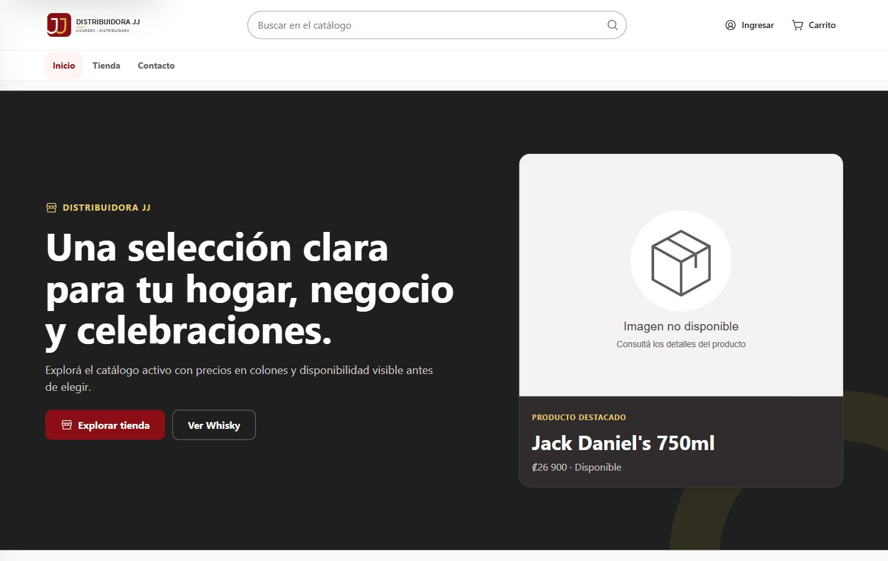
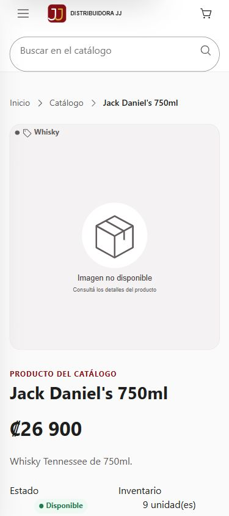

# Distribuidora JJ — Fundaciones Stage 2, bloques 0–3

Fecha: 2026-10-05. Trabajo exclusivamente local en `codex/stage2-design-system`.

Las correcciones compartidas están implementadas y las pruebas automáticas pasan. La revisión pública está realizada a 1440 y 390 px. **No se da por completada la validación visual autenticada de Admin, Inventory, Client y DriverDeliveries**: Edge continúa en Login sin identidad autenticada. Tampoco se certifica operación offline de extremo a extremo con SQL real: las pruebas de cola emplean respuestas simuladas para respetar la prohibición de escribir en la base.

## 1. SHA inicial

`c0c6b326465403f31c2c82c3fe1cf04c3831efe1`. HEAD final sigue en ese SHA.

## 2. Estado Git inicial y protección

16 archivos rastreados modificados, ninguno staged; 104 inserciones y 398 eliminaciones. Había archivos y directorios untracked ajenos, incluidos documentación, presentaciones, caché y herramientas. Se conservaron.

Cuatro cambios previos del usuario: `Views/Fleet/Mileage.cshtml`, `Views/Vehicles/Create.cshtml`, `Views/Vehicles/Edit.cshtml` y `Views/Vehicles/Index.cshtml`. Su diff coincide exactamente con el checkpoint original de octubre 2; no fueron editados en este bloque. Los otros doce cambios rastreados ya presentes correspondían a correcciones parciales del trabajo anterior.

Checkpoint de reanudación en `.git/codex-checkpoints/20261005-foundations-resume`, con SHA, status, patch del working tree, patch del índice y lista de untracked. Es una captura al reanudar; el checkpoint anterior conserva los cambios originales del usuario. No hubo reset, clean ni eliminación de untracked.

## 3. Cambios remotos revisados

Se ejecutó fetch en modo de lectura del remoto. `origin/codex/stage2-design-system` apunta al SHA inicial. `origin/main`: `e8d3f7be3c838a8061a5aacdc8efd25c3fd8e180`.

PR #127: OPEN/CONFLICTING, head `294a84da447eec86cab06ff90922e77618440d36`; ese head es ancestro del HEAD local. PR #120: OPEN/CONFLICTING, head `5739340b4deb862099955cb4b8098880401a2774`; se revisó el alcance de Chat. El estado de las PR corresponde a la consulta de esta sesión.

Los dos commits exclusivos de main incluyen PR #128 y el trabajo móvil/JWT. Se revisaron las diferencias de alcance y el conflicto semántico de numeración de migraciones.

## 4. Integraciones realizadas

Ninguna integración remota ni merge. Las correcciones aquí descritas son locales.

## 5. Integraciones rechazadas o aplazadas

Merge de main aplazado: mezcla migraciones móviles con numeración incompatible y cambios de seguridad fuera de este bloque. No es una integración segura de fundaciones visuales.

PR #127 no se reaplica: ya está contenido en la historia local. PR #120 no se integra completo: no resuelve por sí solo la separación grupos/departamentos y excede el ajuste de presentación solicitado. La corrección pequeña de estado de producto encontrada en main no se recupera: no es necesaria para estos contratos y afecta lógica de negocio.

## 6. Archivos modificados y nuevos

El inventario exacto de rastreados figura en `git-diff-stat.txt` y `git-status-final.txt`. Incluye los cuatro archivos del usuario, que permanecen sin modificaciones adicionales nuestras.

Cambios de este trabajo y parciales preservados:

- Layouts compartidos: `_StorefrontLayout`, `_WorkspaceLayout`, `_FieldLayout`, `_Layout`, `_ValidationScriptsPartial`, `_ViewImports`.
- CSS Stage 2: `base.css`, `components.css`, `storefront.css`, `workspace.css`, `field.css`, `tokens.css`. `utilities.css` se revisó y no necesitó edición.
- JavaScript: `stage2/layouts.js`, `secure-offline-storage.js`, `driver-deliveries.js`; nuevos `driver-route-map.js` y `driver-signature.js`.
- Vistas existentes: Home Index/Shop/Detail/ComboDetail, Cart Index, Inventory Index/Edit, DriverDeliveries Route y Chat Index; controller Chat.
- Branding: SVG compacto existente, ampliando el lienzo para impedir recorte del nombre.
- Imágenes: nuevo `TagHelpers/ProductImageTagHelper.cs` y `img/product-placeholder.svg`.
- Validación: archivos reales de jquery-validation y unobtrusive; nuevo jQuery local y `lib/THIRD-PARTY-NOTICES.md`.
- Pruebas: `OfflineStoragePrivacyTests.cs`; nuevos `ProductImagePresentationTests.cs`, `ChatPresentationStateTests.cs` y `scripts/ui/stage2-foundations.test.cjs`.
- Evidencia y documentación de esta carpeta. Ninguno de estos archivos nuevos fue staged.

## 7. Correcciones P0/P1

Datos de mapas construidos como nodos con `textContent`, sin concatenar nombres ni direcciones en HTML. Las coordenadas se validan y la falta de Leaflet deja instrucciones útiles.

Los archivos locales de validación anteriores eran stubs que aceptaban siempre los formularios. Se restauraron librerías reales, conservando validación servidor y cargando jQuery solo donde el contrato lo requiere en Stage 2. En legacy se reemplazó su dependencia existente por la copia local, sin agregar una segunda carga.

Los tres layouts Stage 2 proporcionan identidad de sesión y storage antes de los scripts de vista. Fallos de almacenamiento ya no pueden presentar un cambio como guardado. La cola conserva el SyncGuid en reintentos, conserva pendientes ante sesión vencida y restaura estado ante rechazo de negocio.

Route vuelve a serializar la firma en el campo enviado y evita enviar un canvas sin firma. Se eliminó la recarga de mapa al reconectar que podía interrumpir la sincronización.

## 8. Correcciones CSS globales

Selectores base con baja especificidad mediante `:where`, para respetar colores de CTA y encabezados. Botón secondary definido, padding/line-height compatibles con texto largo. Variantes de badge success/warning/danger/neutral/info completadas; alineación numérica de tablas protegida; acciones de tabla sin panel recortado; celda primaria de Inventory conserva comportamiento de celda.

Errores y resúmenes de validación tienen estados coherentes. Compra usa un único contrato `djj-product-purchase`. Token `--djj-letter-spacing-wide` definido. Print oculta header/footer reales. Imagen de Detail utiliza altura automática junto al aspect-ratio, evitando conservar 640 px de alto en móvil. No se añadieron reglas `!important` para resolver la cascada.

## 9. Correcciones JS

Fallback de imágenes ante fallos de carga. Manejo de storage denegado y separación por usuario, TTL y limpieza al salir. Actualización de pendientes y restauración de tarjetas. Popup de mapa seguro, guardado de paradas por ruta, fallback por dependencia ausente y firma con pointer events. La caché de paradas no incluye tiles de mapa ni garantiza arranque de toda la aplicación sin red.

## 10. Navegación

Se quitó Perfil duplicado en la navegación inferior Field; quedan dos destinos. Drawer Storefront y sidebar Workspace tienen cierre, Escape, aislamiento de fondo, ciclo de foco y retorno del foco. Workspace conserva colapso/expansión desktop y reinicia correctamente al cambiar a móvil. La lógica existente de permisos se conservó.

La prueba real del drawer móvil confirmó foco en Cerrar navegación al abrir y retorno a Abrir navegación con Escape. Sidebar Workspace se probó en DOM simulado; falta su prueba visual con sesión real. No se redefine aquí navegación por capacidades.

## 11. Branding

Se conserva la identidad Stage 2. Favicon legacy alineado con los assets canónicos Stage 2. Logo horizontal desktop/footer/sidebar con tamaño mínimo apropiado; logo compacto móvil sin deformación, con lienzo corregido para evitar recorte. Una recarga sin caché confirmó el nombre completo; no se rediseñó la marca.

## 12. Imágenes

El TagHelper resuelve archivos públicos existentes y archivos administrados a través del servicio de almacenamiento; cierra el stream, tolera desaparición del archivo y rechaza esquemas/rutas inseguras. Las vistas anotadas utilizan un placeholder neutral cuando falta una imagen. JS cubre fallos posteriores de HTTPS remoto. No se inventaron fotografías.

En Home/Shop/Detail no se observaron imágenes completas con naturalWidth cero. Las imágenes lazy aún fuera de pantalla se clasifican como pendientes, no como rotas.

**Problema de datos pendiente:** “Agua 600ml” muestra una fotografía de whisky que ya está asignada en el catálogo. Una ruta existente no demuestra correspondencia semántica de la fotografía. Corregir esa asociación requiere una tarea de datos autorizada; no se modificó la base.

## 13. Chat: estado real

Error de carga, lista vacía y éxito ya no se renderizan simultáneamente. El fallo de carga se presenta con un mensaje genérico exclusivo; los TempData se muestran una sola vez en el layout legacy. Dos tests de controller distinguen vacío válido de excepción y evitan exponer detalle interno.

No se certifica Chat funcional de extremo a extremo. En la inspección anterior se detectó discrepancia entre grupos y departamentos/procedimientos esperados; no se revalidó el esquema en esta reanudación ni se intentó reconciliarlo. Resolver SQL queda fuera de alcance. La prueba de presentación no acredita disponibilidad de los procedimientos.

## 14. Build

`dotnet build Proyecto_Final.Tests/Proyecto_Final.Tests.csproj -c Debug`: correcto, 0 advertencias y 0 errores. La última edición posterior a la compilación fue exclusivamente `height: auto` en CSS de Detail y se verificó visualmente.

## 15. Tests

`dotnet test Proyecto_Final.Tests/Proyecto_Final.Tests.csproj -c Debug`: correcto. Un test inicial falló porque buscaba storage en el script inline anterior de Route; se actualizó para leer el nuevo archivo externo y la suite completa volvió a ejecutarse.

`node scripts/ui/stage2-foundations.test.cjs`: correcto. Cubre aislamiento/TTL/logout, datos alterados, reintentos e idempotencia cliente, sesión vencida, storage denegado, rechazo de negocio, XSS de mapa, firma, foco y colapso responsive.

`git diff --check`: correcto. Hay avisos de conversión LF/CRLF al consultar algunos diffs; no errores de whitespace.

## 16. Total tests

323 .NET: 0 failed, 0 skipped (baseline 309; 14 casos adicionales). 11 JavaScript: 0 failed, 0 skipped. Total de ejecuciones de casos finales: 334. Las pruebas JavaScript usan DOM y servidor simulados; no sustituyen validación real de Field.

## 17. Console final

Sin errores ni warnings registrados en el tab de QA pública durante las comprobaciones finales de Home, Shop, Detail y Login. Resultado guardado en `public-qa.json`. No se extiende esa afirmación a páginas autenticadas ni a todas las vistas.

## 18. Network y ejecución local

En la captura final de Shop/Detail/Login no hubo loadingFailed ni respuestas >=400. Home también se había comprobado sin fallos de red. Login vacío mostró los mensajes requeridos con **0 POST**, confirmando validación cliente real. API `http://localhost:57541/health` y MVC `http://localhost:5074/health`: HTTP 200.

La configuración habitual apuntaba a Azure SQL, que respondió 40613 y bloqueó la carga pública. Se usó una conexión integrada local exclusivamente en el entorno de los procesos iniciados para esta QA; no se cambió appsettings ni User Secrets. Los health superficiales no prueban disponibilidad de SQL: la carga de Home/Shop sí se comprobó después contra SQL local.

No se enviaron pedidos, actualizaciones de entregas ni evidencias a la base. Las comprobaciones SQL efectuadas fueron de solo lectura. API y MVC quedan ejecutándose para permitir el login pendiente.

## 19. git diff --stat

`git-diff-stat.txt`: 33 archivos rastreados, 267 inserciones y 558 eliminaciones. Incluye los cambios previos del usuario y los parciales anteriores. No incluye archivos nuevos untracked, por lo que no representa por sí solo el tamaño total del trabajo.

## 20. git status final

`git-status-final.txt` conserva la salida exacta: working tree modificado, ningún staged, archivos nuevos y untracked previos preservados. Los snapshots no incluyen una enumeración recursiva innecesaria de caché.

## 21. Ahead/behind final

Frente a `origin/codex/stage2-design-system`: 0 ahead / 0 behind. Frente a `origin/main`: 52 ahead / 2 behind. Estos números cuentan commits, no las modificaciones sin commit.

## 22. Commits locales creados

0. No se hizo staging. El SHA inicial y final coinciden.

## 23. Confirmaciones y pendientes

**NO PUSH. NO PR. NO ESCRITURA REMOTA.** No merge de main, no migraciones, no cambios de base de datos, no cambios de User Secrets, no borrado de untracked ni migración de las ~55 vistas legacy.

Pendiente para cerrar completamente el gate: sesión real en Edge y QA de Admin/Inventory/Client/DriverDeliveries a 1440/390 con consola/red, según permisos reales. No se fabricará una sesión ni se saltarán permisos. La prueba real de sincronización/idempotencia con backend requeriría permitir cambios en datos de prueba; aquí solo queda cubierta la parte cliente por simulación.

Decisiones a escalar antes de futuras migraciones: reconciliar Chat grupos/departamentos, estrategia de migraciones entre ramas y navegación por rol/capacidades. No bloquean las correcciones locales ya implementadas, pero sí su certificación integral y nuevas migraciones amplias.

## Evidencia visual

`home-1440.png`, `home-390.png`, `shop-1440.png`, `shop-390.png`, `detail-1440.png`, `detail-390.png`, `login-validation-1440.png`, `login-validation-390.png`.

